# Snappy

Snappy helps you tidy your Snapchat friends list and rescue your Memories, using only the data export Snapchat gives you.

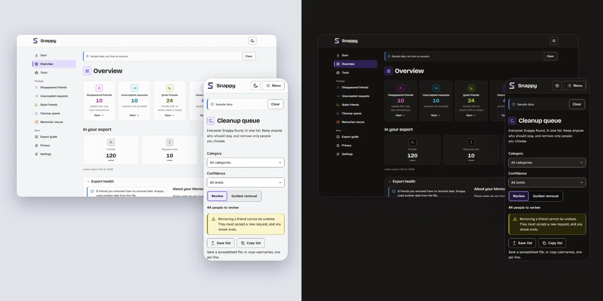

- **Cleanup queue.** Finds disappeared friends (people who may have removed you), unaccepted requests, and quiet friends, each with a confidence level and the evidence behind it. Saved chats and Snaps both count as activity, so a friend you only Snap with is not called quiet.
- **Memories rescue.** Plans a local backup of your Memories, shows a storage meter against a 5 GB cap that you can change, and restores each file’s exact capture time. In a newer export the files are inside the ZIP files, and Snappy pairs each one with its list entry by that exact time.
- **Tools.** Twenty-two small tools on the dashboard’s Tools page, such as an export check, a Memories storage planner, a friends backup, a year in review and a list of people waiting on a reply. Each reads metadata only and shows the matching command with Copy and Run.
- **Native apps and a command line tool.** Snappy is an app you install: a Windows beta is the first one, a macOS beta is built and tested by automation (see [docs/MACOS.md](docs/MACOS.md)), and Linux and phone apps are planned. There is also a command line tool named `snappy-export`.

Snappy only infers. A result means “may have removed you”, never “did”. Removing a friend is always your call, and you do it in Snapchat yourself.

## Screenshots

Every picture here is a real capture of Snappy’s built-in sample data: invented friends such as `ghost_1`, never a real account. [docs/images/README.md](docs/images/README.md) shows them all and says how to make them again.

| Light | Dark |
|---|---|
| 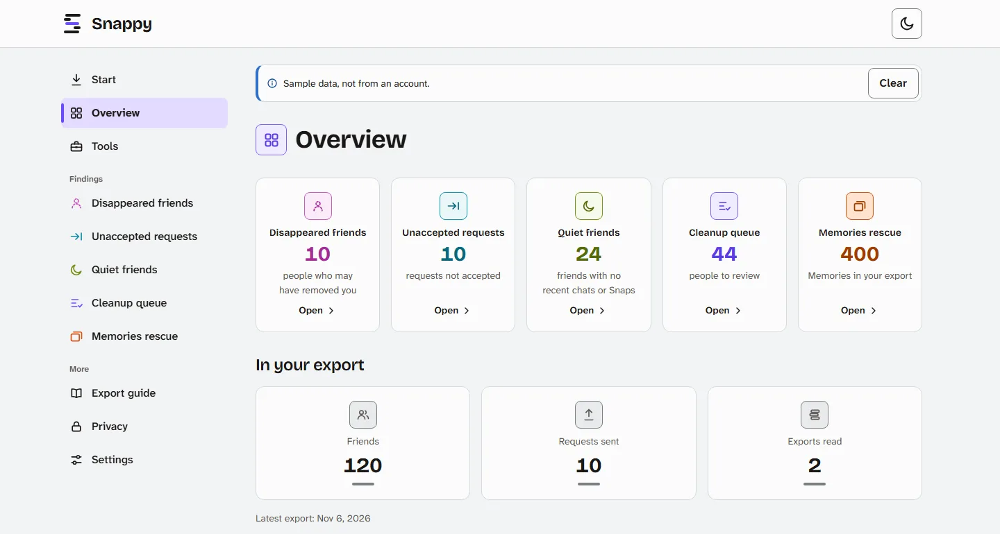 | 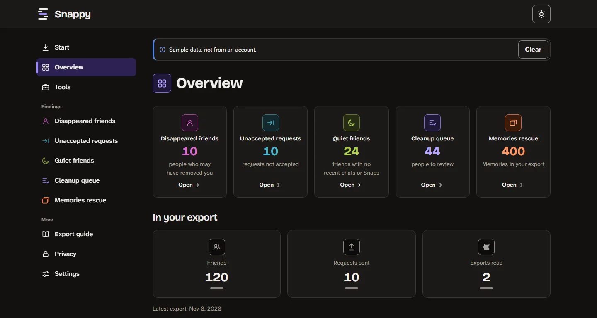 |
| 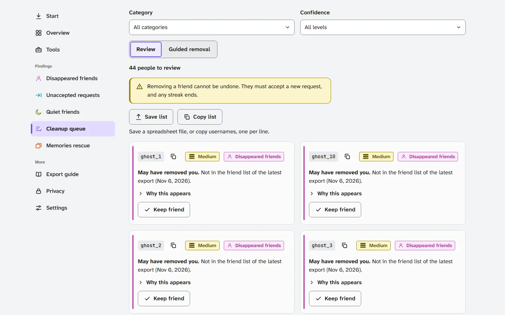 | 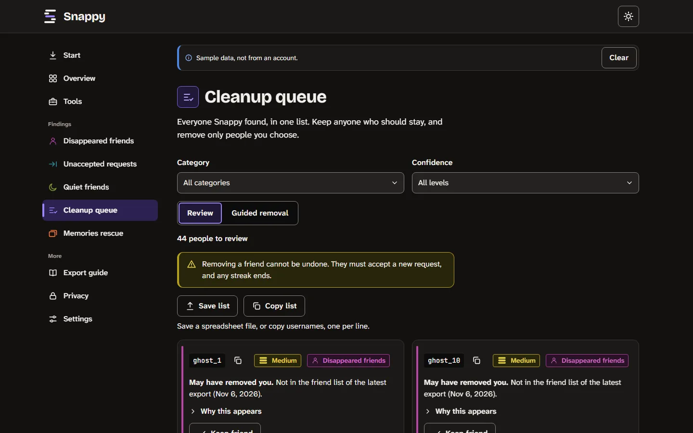 |
| 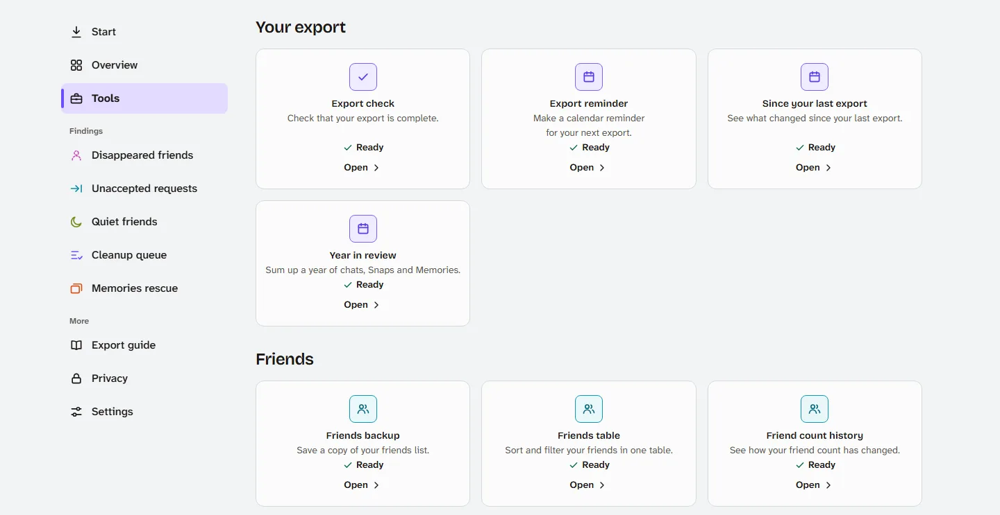 | 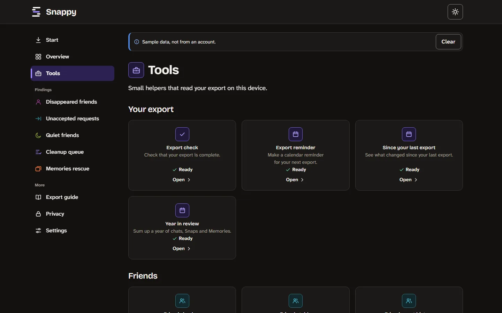 |
| 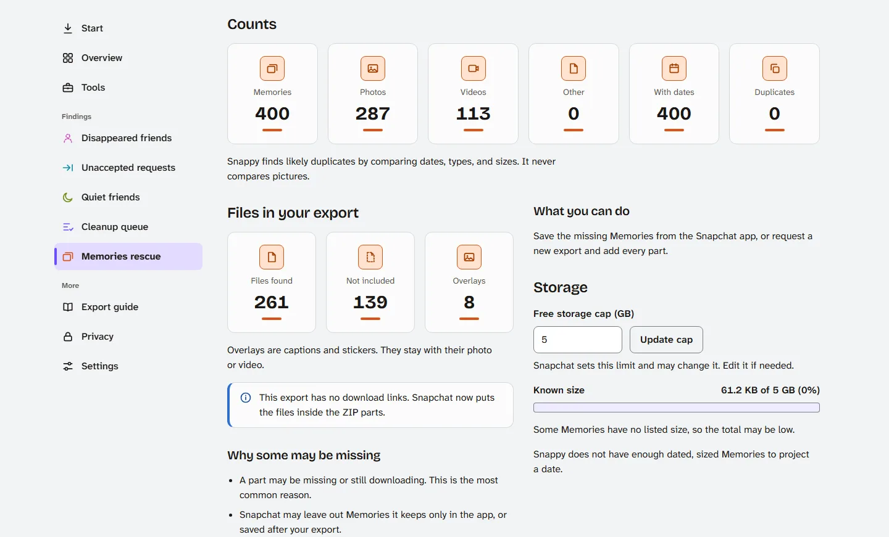 | 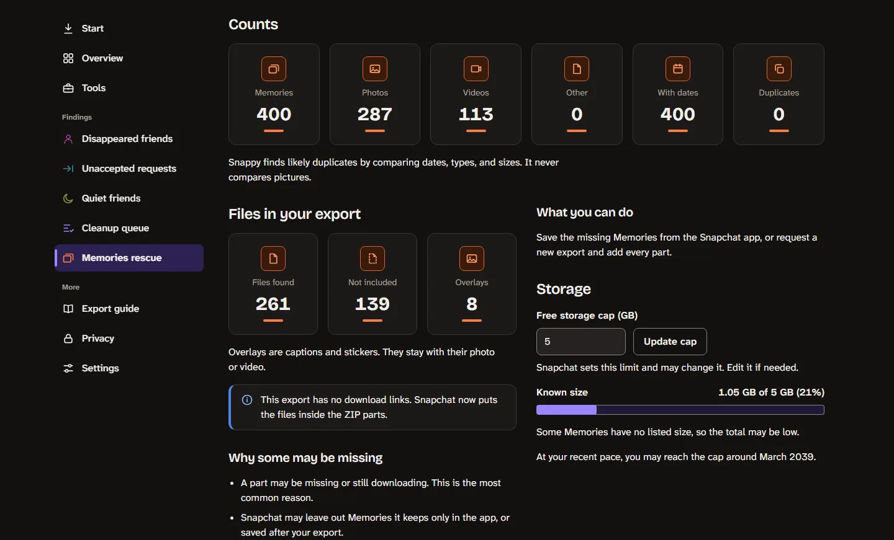 |

A command shown in the app has Copy and Run. Run works inside the app, on invented data here:

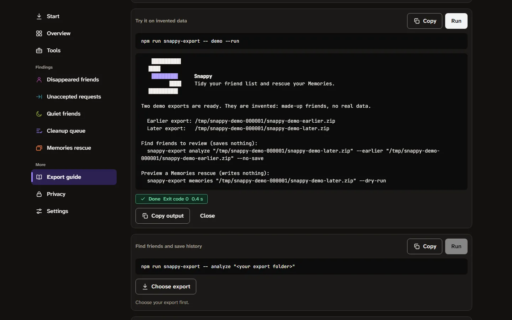

## On your phone

The same pages fit a phone-size screen. These are captures at 390 by 844 pixels: Overview, Tools, Cleanup queue and the Year in review tool, in the light and the dark theme.

| Overview | Tools | Cleanup queue | Year in review |
|---|---|---|---|
| 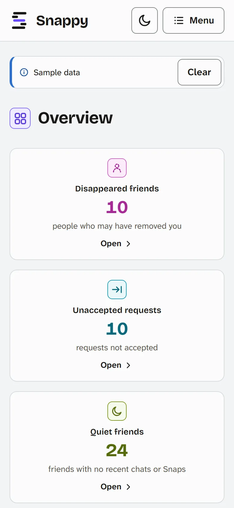 | 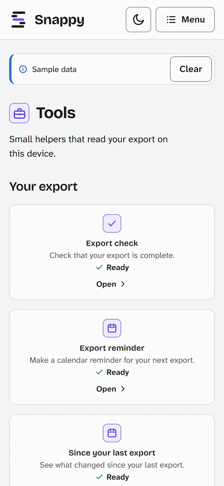 | 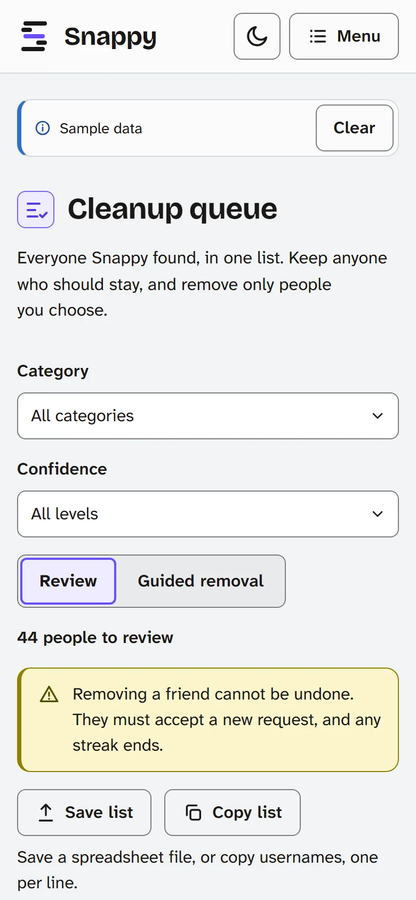 |  |
| 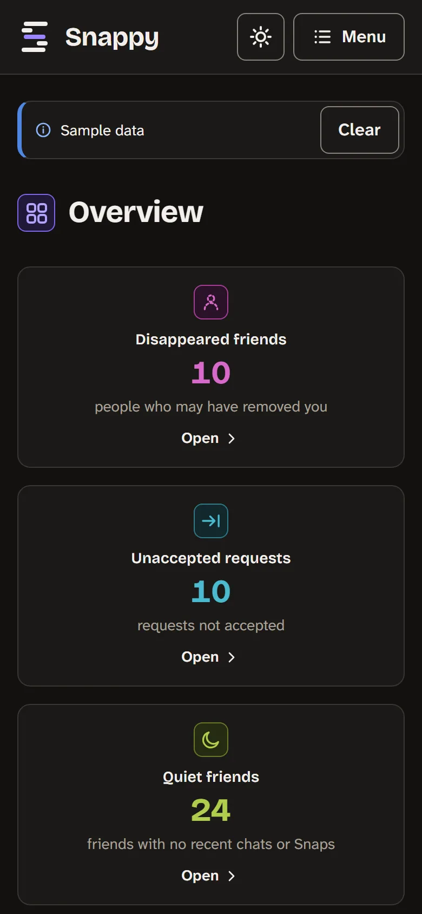 | 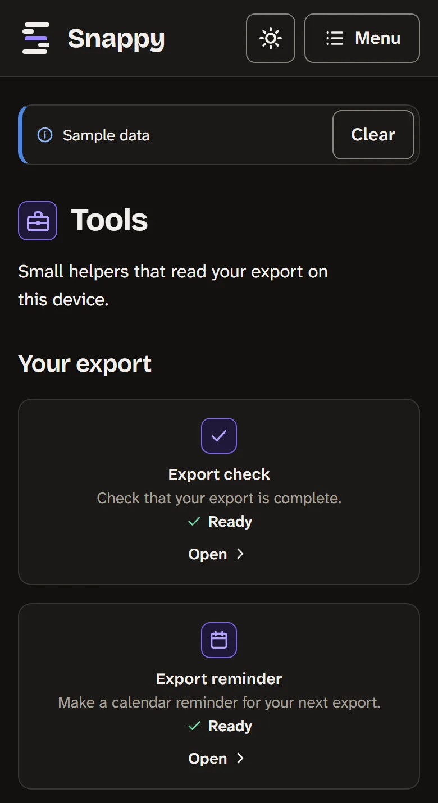 | 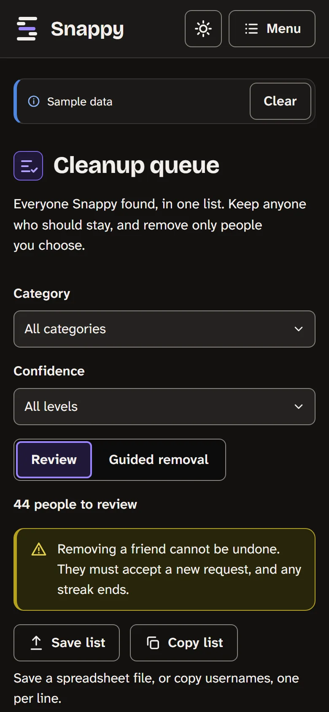 |  |

These were made in a headless browser, and the iPhone sizes in Safari’s engine (WebKit), not on a phone. The phone apps are planned, and their own screenshots come with them.

## Desktop app (Windows beta)

The Windows beta shows this same dashboard in its own window. Beta 2 adds an automatic update check, which you can turn off in Settings. [docs/BETA.md](docs/BETA.md) says how to install it and what to expect.

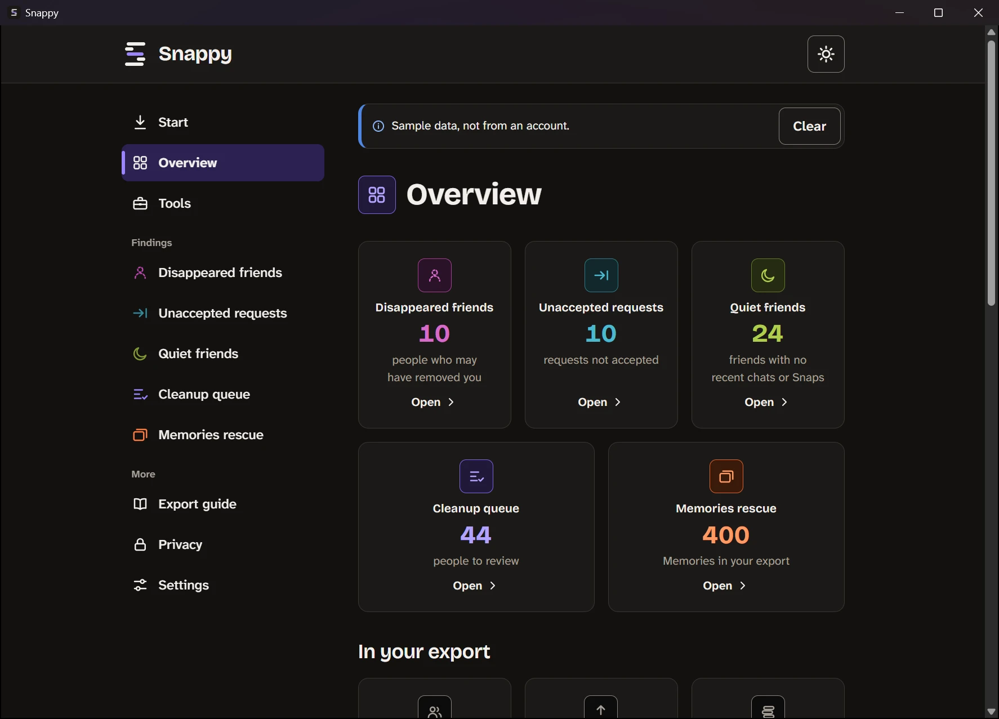
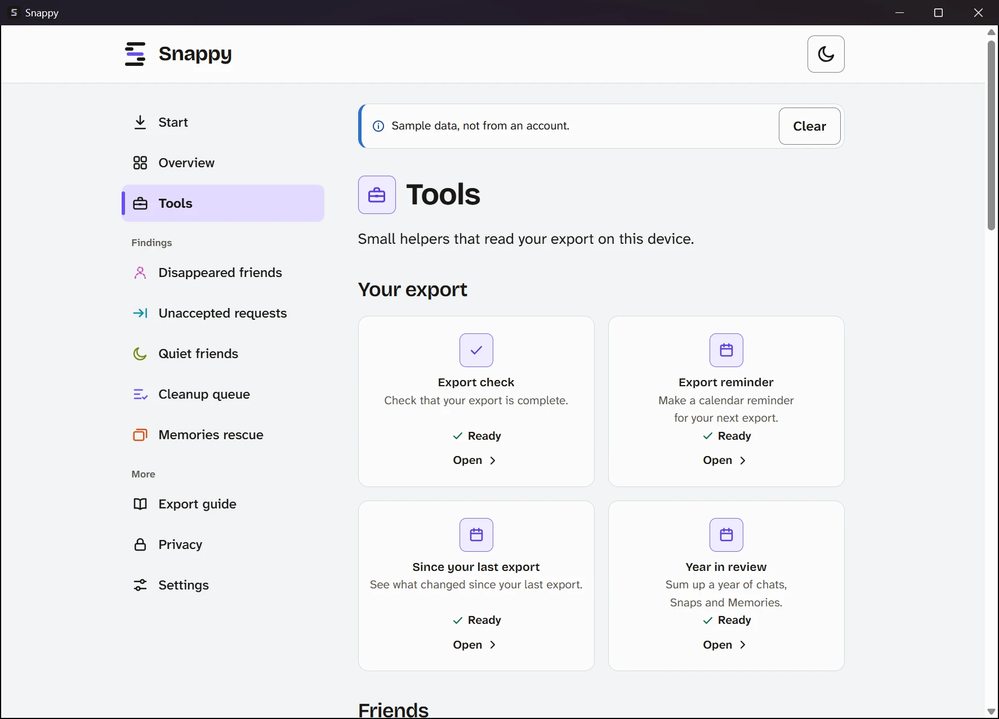

## Privacy model

1. Snappy is content-blind. It never views messages, photos, videos, or locations.
2. The only personal value it handles is a friend’s username, shown in a monospace font.
3. Everything runs on this device, apart from the two optional network features in item 5. The app’s page is one HTML file with a policy that blocks all network access.
4. There is no account, no telemetry, and no analytics.
5. There are two network features, and nothing else touches the network. One is `snappy-export memories --download` in the command line tool. It is off by default, it prints a notice, and it contacts only the links inside your own export (newer exports have no links, so it has nothing to download). The other is the Windows app’s update check: one fixed address on github.com, no ID and none of your data, and you can turn it off in Settings ([docs/UPDATES.md](docs/UPDATES.md)). The app’s page itself can never connect to anything.
6. Your saved history is kept only if you choose, encrypted with your passphrase (PBKDF2 and AES-256-GCM). Snappy never stores the passphrase.
7. Output never echoes message text, display names, group titles, locations, or download links.
8. Tests seed every one of those values into a synthetic export and fail if any of them reaches an output.

## Quick start

### 1. Get the app

The current build is **Windows beta 2** (`0.1.0-beta.2`). It is unsigned, so Windows shows a warning. New in beta 2: the app checks GitHub for an update when it opens, and an **Update now** button and an **Updates** card in Settings let you check by hand or turn the check off. The check asks github.com for a small file and sends no ID and none of your data (the wording awaits the project owner’s approval; [docs/UPDATES.md](docs/UPDATES.md) is the decision record). Beta 1 had no updater, so moving from beta 1 to beta 2 takes one manual install. [docs/BETA.md](docs/BETA.md) says how to install it, where it keeps its data, how to remove it and how to report a problem without sharing anything personal. [docs/RELEASES.md](docs/RELEASES.md) says where installers come from and how to check one. A **macOS beta** (one universal app, unsigned) is built by CI but has not been run on a real Mac yet; [docs/MACOS.md](docs/MACOS.md) says how to install it.

### 2. Get your export

Request your data in Snapchat under Settings, then My Data. Select “Export JSON files” and “User information”, and choose “All Time” as the date range. The full steps are in [docs/EXPORT-GUIDE.md](docs/EXPORT-GUIDE.md).

### 3. Use the app

Open Snappy and select Choose ZIP files on the Start page (or drop your ZIP files there), or choose “Use sample data” to look around with made-up friends first. The Tools page lists the tools: each opens its own page, says what it reads, and runs on the export already in the app. The safety and privacy checklists hold your own marks: they are kept only if you save your history with a passphrase in Settings, and until you close Snappy otherwise. Every command shown in the app has Copy and Run, and Run works inside the app.

### 4. Use the command line

The command line tool is a separate download: it is in this repository, and the installed app does not include it. A full Memories rescue needs it. You need Node 22.18 or later (Node 24 works). Then, from this folder:

```
npm install
npm run snappy-export -- help
npm run snappy-export -- demo --run
```

| Command | What it does |
|---|---|
| `snappy-export analyze <ZIP files or folder...>` | Reads the export, updates your saved history, and prints the cleanup queue. |
| `snappy-export memories <ZIP files or folder...> --out <folder>` | Copies bundled Memories with their capture date restored. Add `--dry-run` to preview, or `--download` for link-only items. |
| `snappy-export inspect <ZIP files or folder...>` | Prints the structure of the JSON files (field names and types), never a value. Photos, videos, and web pages are only counted. Options: `--show-keys`, `--layout`, `--memory-links`, `--mtime-check`, and `--checks-only`. |
| `snappy-export keep <username...>` and `snappy-export unkeep <username...>` | Protects friends from the cleanup queue. |
| `snappy-export history status` | Lists the exports in your saved history: dates and friend counts, never usernames. |
| `snappy-export demo` | Writes two invented exports and prints commands to try them. |

Twenty-two more commands (`check`, `storage`, `backup`, `closest`, `remind`, `since`, `year`, and others) are listed in [apps/cli/README.md](apps/cli/README.md#more-commands). Run `snappy-export help` to see them all.

Examples:

```
npm run snappy-export -- analyze later.zip --earlier earlier.zip --no-save
npm run snappy-export -- analyze later.zip --json
npm run snappy-export -- memories mydata~1234567890123.zip mydata~1234567890123-2.zip --out rescued-memories --dry-run
npm run snappy-export -- memories mydata~1234567890123.zip --out rescued-memories --layout year-month
```

Several ZIP files, a folder of ZIP files, or a wildcard such as `"mydata*.zip"` are the parts of one export. Snappy puts them in the order Snapchat numbers them (the name without a number, then `-2`, then `-3`), whatever order you type them in. Without `--no-save`, `analyze` keeps one encrypted file (your saved history of past exports, with your keep list inside) in `~/.snappy/` so each new export is compared with the earlier ones. Disappeared friends need at least two exports. The passphrase comes from `--passphrase-file`, then `SNAPPY_PASSPHRASE`, then a hidden prompt.

Exit codes: 0 done, 1 could not run, 2 the export has errors, 3 Memories finished with some failed items. More detail is in [apps/cli/README.md](apps/cli/README.md).

### What it reads, and how much

- **Chats and Snaps.** Snappy reads `chat_history.json` and `snap_history.json` as who, when, direction and type. Both are streamed from the ZIP file in small pieces, so there is no practical limit on how many conversations or messages you have, and message text is never decoded. The friends list and the Memories list are streamed the same way: only the fields Snappy uses are decoded, so display names and locations are skipped as bytes. Every entry is checked against the checksum the ZIP file stores, so a damaged download fails loudly instead of passing as good data.
- **Memories pairing.** For each Memory, Snappy looks for the file stored with exactly that capture time (to the second). It reports counts and the method, such as “200 of 300 Memories are matched to a file in your ZIP files by exact capture time”, and counts the ones with no file instead of guessing.
- **Large exports.** The dashboard reads big files in a background worker started from a `blob:` URL that the page makes itself, so the window stays responsive. The page still cannot reach the network.
- **The inspect command.** It shows the shape of your export so you can share it safely. The extra checks (`--layout`, `--memory-links`, `--mtime-check`) print counts and masked patterns, never a name or a value. The steps are in [docs/EXPORT-GUIDE.md](docs/EXPORT-GUIDE.md).

Snapchat has not published the exact layout of its export, so Snappy reads it tolerantly and reports anything unexpected. Both the dashboard and the CLI show those notes before any result.

## Repository layout

```
packages/core     Parsing, saved history, detectors, cleanup queue, Memories planning,
                  metadata writers, encryption, and synthetic test data (@snappy-export/core)
apps/cli          The snappy command
apps/dashboard    The dashboard (builds to one HTML file that the apps show)
apps/app          The desktop app: the dashboard in a native window (Tauri)
brand             Logo, color and type tokens, icons
docs              Brand guide, export guide, releases guide, beta guide and screenshots
```

## For developers

You need Node 22.18 or later and, for the desktop app, a stable Rust toolchain. Run `npm install` in this folder first.

```
npm run build:dashboard                          # writes apps/dashboard/dist/index.html
npm run serve -w @snappy-export/dashboard        # serves it on 127.0.0.1, for development only
npm run dev -w @snappy-export/app                # the desktop app in a development window
npm run build -w @snappy-export/app -- --bundles nsis   # the Windows installer
npm run screenshots                              # redraws docs/images from the sample data (see docs/images/README.md)
```

The dashboard’s single HTML file is what the apps show, and the local server is a way to work on it, not a way to use Snappy. [apps/app/README.md](apps/app/README.md) has the desktop app’s rules and checks, and [docs/RELEASES.md](docs/RELEASES.md) has the build steps and the Windows beta build. To change the code, read [CONTRIBUTING.md](CONTRIBUTING.md).

## Run the tests

```
npx vitest run
npx tsc --noEmit -p tsconfig.json
```

All tests use synthetic data. Nothing in this repository needs, opens, or reads a real Snapchat export, and you should not add one.

## Brand

Colors, type, icons, and voice are defined in [docs/BRAND.md](docs/BRAND.md). The tokens in `brand/tokens/tokens.css` are the source of truth.

## Not affiliated

Snappy is an independent tool. It is not affiliated with, endorsed by, or sponsored by Snap Inc. Snapchat is a trademark of Snap Inc.

## License

Snappy is open source under the [Apache License 2.0](LICENSE). Third-party components and fonts are listed in [THIRD-PARTY-NOTICES.md](THIRD-PARTY-NOTICES.md), and [NOTICE](NOTICE) carries the copyright line. To contribute, read [CONTRIBUTING.md](CONTRIBUTING.md); to report a security problem, read [SECURITY.md](SECURITY.md). Names and logos are covered in [TRADEMARKS.md](TRADEMARKS.md).

## About the name

The product is called **Snappy**. The word is already used by other software, including Google’s Snappy compression library, so the published package and command line tool use the more specific name `snappy-export`.