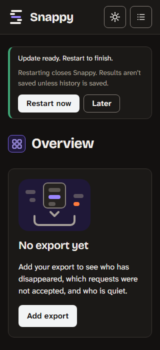
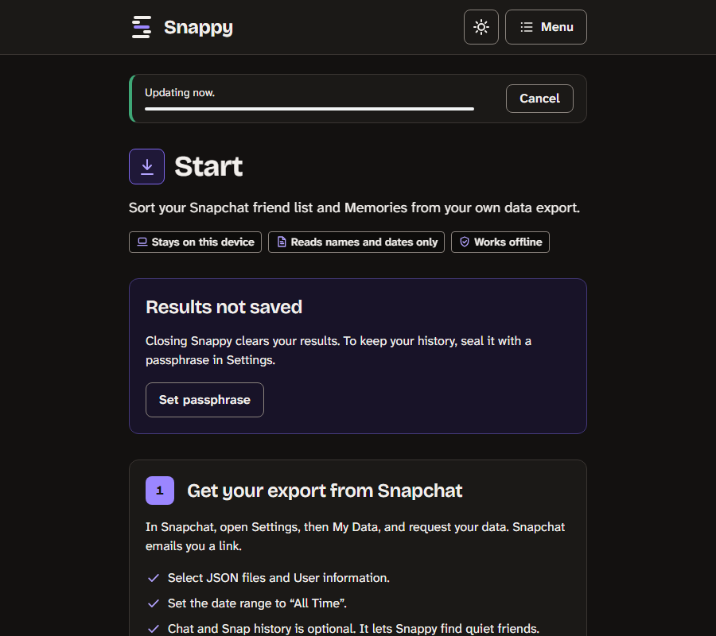
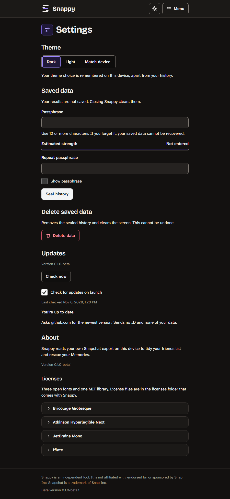
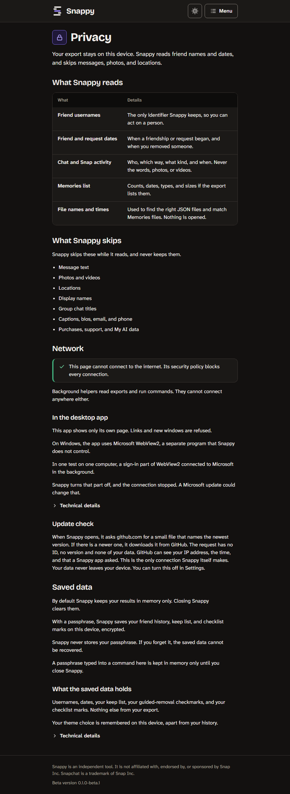

# Updates: decision record

Status: built and tested without a window, not released. The wording in “Wording awaiting the owner’s approval” is a draft that the owner has not approved. The real-install checks are listed in “What has not been run”.

## What changed, and why

Until now Snappy had no update check. A person who installed the Windows beta had to come back to the Releases page and download a newer installer by hand, and most people never would. The owner decided that the desktop app should check GitHub when it opens, apply an update by itself when that is safe, and offer an Update now button when the automatic path fails, so nobody has to download Snappy again to keep getting fixes.

The trust rule does not change. Nothing about the person or their data leaves the device. There is no telemetry, no analytics and no account. The update check is the only network use of the desktop app, it is made by the program and never by the page, and the page’s security policy still forbids every connection.

This reverses the earlier line in the releases guide that said Snappy never checks for updates. Windows comes first. The Mac, Linux and phone apps are not part of this decision: the stores update the phone apps, and the other desktop systems need their own mechanism.

## How it works

- The program asks one fixed address on github.com for a small file that names the newest version. It asks once an hour at most, a few seconds after the window opens, and only when the setting is on and the first-run notice has been shown.
- If the file names a newer version, the program downloads the installer from the matching fixed address, checks its signature, and keeps it ready. When nothing is in progress, the update is applied the next time Snappy opens, before the window appears. The person can also choose Update now.
- Everything that decides what is downloaded and installed is in the Rust program (`apps/app/src-tauri/src/updater`). The page never supplies an address, a host, a header, a version or a path. It can ask five questions and give two orders: ask for the status, check now, install the file that is ready (it says whether it is idle), switch the check on or off, and open the fixed releases page after repeated failures.
- A new version must be higher than the running one. A downgrade is refused twice: by the program, and by the installer.

## Signing is offline

Updates are signed with a minisign key. The signing key is never in GitHub, not as a secret and not in a workflow. The maintainer signs the exact installer they tested, on their own computer, with a tool in `apps/app/tools`. The release workflow builds unsigned files and attaches a checksum and a build attestation to a draft. A second key, the recovery key, stays offline on separate media and is used only to rotate the first.

Why: the threats that matter most are a takeover of the GitHub account, a poisoned dependency in the build, and a malicious collaborator. With the key in GitHub each of them can read it. With an offline key they can swap a file in a draft, but no installed copy accepts a file that our key did not sign. A swap that the maintainer signs by mistake is what the signing tool’s provenance, product-version and higher-version checks are for. They lower that risk, and the maintainer installing and running the exact file first is the check that matters. It also means the maintainer installs and runs the same bytes they sign.

Both public keys are compiled in. Release builds refuse to compile with placeholder keys or with test keys.

## Threat model in short

| Threat | What stops it |
| --- | --- |
| A forged or swapped installer | Signature check against two compiled-in keys, signed file name and version, exact download address, size caps. The staged file is checked again, under an exclusive handle, just before it runs. |
| A redirect or a look-alike address | Each address is parsed once. Only `https` on the default port, no user info, no IP addresses, `github.com` first and then `github.com` or `githubusercontent.com` hosts, at most four redirects, all checked on every hop. |
| A downgrade or a replay | The version must strictly increase and is bound to the signature. The installer refuses downgrades too. |
| A page that tries to steer an update | The page cannot choose what is installed. At worst it restarts the app, switches the setting, or opens the fixed releases page after failures. |
| Updating in the middle of work | The program restarts only when the page says it is idle and no picked file is open. Otherwise the update waits for the next launch. |
| Another copy or a higher privilege | The updater runs only from the per-user installer’s folder, never elevated, and never while another Snappy process exists. |
| A compromised build dependency | Not eliminated. The maintainer installs and runs the exact file before signing, builds are locked, and a daily public check compares the published files with the keys. |

Not covered: someone who holds the signing key can target copies that have not updated yet, until those copies update. Rotating keys is documented in the release runbooks.

## What is sent

One request for the small file, and, only if a newer version exists, one request for the installer. The only header the program sets is `User-Agent: Snappy-Updater`. There is no query string, no ID and no version number. GitHub, the network and any proxy can see the IP address, the time, and that a Snappy app asked. When an update is downloaded, the address names the version about to be installed. Windows may look up a proxy configuration, which a local network can see.

This does not cover WebView2, the Microsoft web engine that draws the window. It is a separate program that Snappy does not control. The notes in the app’s README say what was and was not tested.

## Wording awaiting the owner’s approval

The text below is a draft. It is built into the desktop app only, and the web build does not contain it.

| Where | Text |
| --- | --- |
| Privacy page, “Update check” block | When Snappy opens, it asks github.com for a small file that names the newest version. If there is a newer one, it downloads it from GitHub. The request has no ID, no version and none of your data. GitHub can see your IP address, the time, and that a Snappy app asked. This is the only connection Snappy itself makes. Your data never leaves your device. You can turn this off in Settings. |
| Settings, Updates card note | Asks github.com for the newest version. Sends no ID and none of your data. |
| First-run notice | Snappy checks GitHub for updates when it opens. Change this in Settings. (Buttons: OK, Turn off.) |

The earlier draft of the Settings line said “Sends nothing about you.” It was changed because an IP address, and the fact that a Snappy app asked, are things about the person.

## What it looks like

Headless captures of the built desktop page with a scripted stand-in for the shell, using made-up data. They are not captures of the app window.

## Where things are

- The program side: `apps/app/src-tauri/src/updater` (the README next to it lists the files). The page side: `apps/app/src/update-*.ts`, in the desktop entry only, so the web build is byte for byte unchanged (`apps/app/tools/check-web-build-unchanged.mjs` proves it against a git ref).
- The two public keys: `apps/app/src-tauri/update-public-keys.txt`. They are placeholders until the maintainer fills them, and a release build refuses to compile with placeholders or test keys.
- Signing and checking: `apps/app/tools/sign-release.mjs`, `apps/app/src-tauri/examples/verify_manifest.rs`, `.github/workflows/verify-published.yml`. Steps: [UPDATE-RUNBOOKS.md](UPDATE-RUNBOOKS.md).
- The Windows transport is the system’s WinHTTP, called from one file. If it misbehaves behind a proxy on a real machine, the fallback is the Tauri updater plugin, wrapped with its own address pinning and limits and with no updater permission granted to the page. That switch has not been built.

## What has not been run

The update drill (`apps/app/test/e2e-update`) installs and starts the app, so it needs a window: the real `/UPDATE` install over an installed copy, data surviving it, Smart App Control, the elevated and second-process cases, an installer killed mid-run, WinHTTP behind a proxy or PAC file, and the live GitHub redirect chain. Everything else above was tested against a loopback server and test keys.

## Installer facts

These were read from the NSIS script that the Tauri tooling generated for the Windows beta build (`target/release/nsis/x64/installer.nsi`, tauri-cli 2.12). They were not run: an install is a step for the first-release drill.

- The program starts the installer with `/P /UPDATE /R`. `/P` is the passive progress window, `/UPDATE` is update mode, and `/R` starts the app again when the install ends (only in passive and silent modes).
- In update mode the installer skips the reinstall page, does not run the uninstaller first, skips the WebView2 download, and does not delete app data. The uninstaller removes the app’s data folders only when the person ticks the box in the uninstaller and update mode is off.
- With `allowDowngrades` set to `false` in the config, passive, silent and update runs stop when the installer is older than the installed version. The comparison is a semantic version one, so `0.1.0` is newer than `0.1.0-beta.1`.
- The per-user installer records its folder in `HKCU\Software\<publisher>\<product name>` (the default value), and as `InstallLocation` under `HKCU\Software\Microsoft\Windows\CurrentVersion\Uninstall\<product name>`. The program reads the first of these to decide whether it is the installed copy.
- The program file carries the version as its product and file version (`0.1.0-beta.1` for the beta). The installer file carries the numeric version.

Not run: the interactive installer, `/UPDATE` over a real install, data preservation across an update, Smart App Control, and an install on a machine without WebView2.
